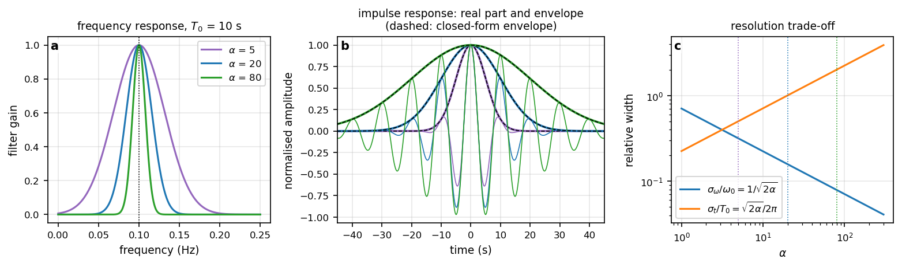
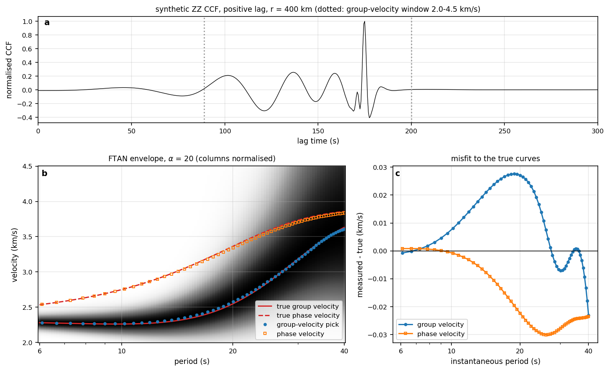
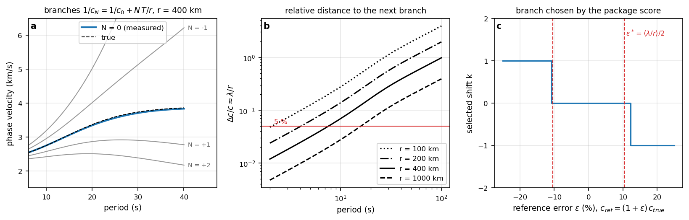
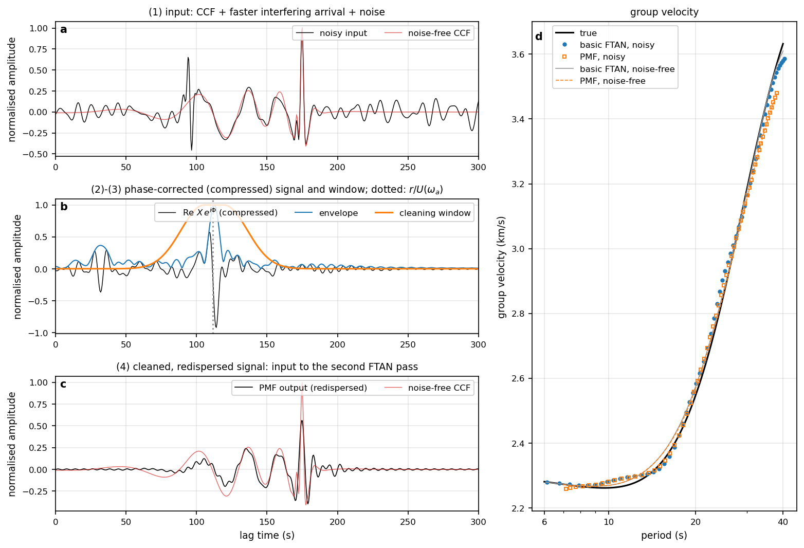

# Dispersion Measurement: FTAN and Phase-Matched Filtering

!!! note "Draft"
    Method page under review. Statements that could not be checked against
    the code or a source are marked **Unverified**. Code references are to
    `seisforge.ant.aftan` (`core.py`, `phase.py`, `snr.py`, `taper.py`) and
    `seisforge.ant.filters`.

A cross-correlation between two stations contains a dispersed surface wave:
each frequency travels with its own group velocity $U(\omega)$ (the speed of
energy) and phase velocity $c(\omega)$ (the speed of a crest). Frequency-time
analysis (FTAN; Dziewonski et al. 1969; Levshin et al. 1972) measures both
from one trace. The idea is old and simple:
split the trace into narrow frequency bands, find when the energy of each
band arrives (group velocity), and read the phase of the band at that time
(phase velocity). The difficulties are all in the details: what phase a
noise correlation *should* have, how narrow the bands can be, what the
"frequency" of a measurement is, and how to pick the right one of infinitely
many phase-velocity curves. This page derives each step.

## 0. Notation and conventions

| symbol | meaning | unit |
|---|---|---|
| $r$ | interstation distance (`distance_km`, SAC `dist`) | km |
| $t$ | lag time of the CCF branch, $t\ge 0$ | s |
| $\omega = 2\pi/T$ | angular frequency, $T$ period | rad/s, s |
| $k(\omega) = \omega / c(\omega)$ | wavenumber | rad/km |
| $c$, $U = d\omega/dk$ | phase and group velocity | km/s |
| $\hat x(\omega) = \int x(t)\,e^{-i\omega t}\,dt$ | Fourier transform (`scipy.fft.fft`) | |
| $x(t) = \frac{1}{2\pi}\int \hat x(\omega)\,e^{+i\omega t}\,d\omega$ | inverse (`ifft`), kernel $e^{+i\omega t}$ | |
| $\omega_0$, $T_0$ | centre of one Gaussian filter | rad/s, s |
| $\alpha$ | Gaussian filter parameter (dimensionless) | |
| $S(t;\omega_0) = A\,e^{i\varphi}$ | filtered analytic signal; envelope $A$, phase $\varphi$ | |
| $\phi_0$ | phase constant of the far-field CCF (§1) | rad |
| $p$ | `pi_over_4`; the code adds $p\,\pi/4$ to the measured phase, $p = -4\phi_0/\pi$ | |
| $N$ | integer number of $2\pi$ cycles | |
| $\lambda = cT$ | wavelength | km |

With this transform a wave $\cos(\omega t - kr + \phi_0)$, a crest that
reaches distance $r$ at $t = r/c$, has spectrum proportional to
$e^{-i(kr - \phi_0)}$ at positive $\omega$. Every sign below follows from
this choice.

## 1. The phase of a noise correlation

### Where the $\pi/4$ comes from

That noise correlations contain usable surface waves was shown by Shapiro &
Campillo (2004); the stationary-phase argument behind it is in Snieder
(2004). Consider the ZZ correlation of a diffuse field of plane Rayleigh waves:
waves of equal strength arrive from every horizontal direction $\hat d$. A
plane wave has vertical spectrum $Z(\mathbf x) = W e^{-ik\,\hat d\cdot\mathbf
x}$. With A at the origin and B at $r\hat x$, the correlation spectrum
$\overline{Z_A}Z_B$ averaged over the propagation angle $a$ between $\hat d$
and $\hat x$ is

$$
\hat C_{ZZ}(\omega) = W\,\frac{1}{2\pi}\int_0^{2\pi} e^{-ikr\cos a}\,da = W\,J_0(kr),
$$

the integral representation of the Bessel function $J_0$. The correlation
is a *standing* pattern in space; a travelling wave appears only after it is
split into its two time directions. For $kr \gg 1$,

$$
J_0(x) \simeq \sqrt{\frac{2}{\pi x}}\cos\!\left(x - \frac{\pi}{4}\right)
= \sqrt{\frac{1}{2\pi x}}\left[e^{\,i(x - \pi/4)} + e^{-i(x - \pi/4)}\right].
$$

Multiplied by $e^{+i\omega t}$ in the inverse transform, the second term
gives $e^{i(\omega t - kr + \pi/4)}$: a wave arriving at positive lag
$t \approx r/U$ with phase constant $\phi_0 = +\pi/4$. The first term is
its mirror at negative lag, with the *same* constant after time reversal.

Physically the $\pi/4$ is the price of summing over directions. Only waves
travelling close to the line A→B (or B→A) add coherently; their path
difference grows quadratically with the angle away from that line, so the
sum is a Fresnel integral, and a Fresnel integral over a quadratic phase
contributes $e^{\pm i\pi/4}$. In a 3-D (body-wave) field the same argument
gives $\pi/2$.

!!! note "C or its derivative"
    Several papers relate the Green's function to the *time derivative* of
    the correlation. Differentiating multiplies the spectrum by $i\omega$ and
    shifts every phase constant by $+\pi/2$. SeisForge measures the CCF
    itself, so the constants below are for $C$, not for $dC/dt$.

### Component by component

The same average (Lin et al. 2008; for ZR and RZ, Lin et al. 2014) with the horizontal polarisation of a retrograde Rayleigh
wave, $H = i\varepsilon\,\hat d\,Z$ ($\varepsilon > 0$ the H/V ratio), and
the package's radial axes (both pointing from B back to A, see
[Rotation §1](rotation.md#the-rotated-axes-used-by-seisforge)) gives
$\hat C_{ZR} = -\varepsilon J_1$, $\hat C_{RZ} = +\varepsilon J_1$,
$\hat C_{RR} = \varepsilon^2(J_0 - J_2)/2$, and for Love waves on TT
$(J_0 - J_2)/2$. With $J_n(x) \simeq \sqrt{2/\pi x}\cos(x - n\pi/2 - \pi/4)$:

| component | far-field form of $\hat C$ | $\phi_0$ | $p$ needed | $p$ in the code today |
|---|---|---|---|---|
| ZZ | $+\cos(kr - \pi/4)$ | $+\pi/4$ | $-1$ | $-1$ |
| RR | $+\cos(kr - \pi/4)$ ($J_2 \simeq -J_0$) | $+\pi/4$ | $-1$ | $-1$ |
| TT (Love) | $+\cos(kr - \pi/4)$ | $+\pi/4$ | $-1$ | $-1$ |
| ZR | $-\cos(kr - 3\pi/4)$ | $-\pi/4$ | $+1$ | $+1$ (positive lag), $-1$ (negative lag) |
| RZ | $+\cos(kr - 3\pi/4)$ | $+3\pi/4$ | $-3$ | $-1$ (positive lag), $+1$ (negative lag) |

The full derivation, the numerical check with synthetic diffuse fields, and
the history of the table are on the page
[AFTAN phase constants](../aftan_phase_constants.md).

!!! danger "Known issue, not fixed: ZR and RZ phase constants"
    The automatic `pi_over_4` for **RZ** (both branches) and for **ZR on the
    negative branch** in `ant/aftan/phase.py` (`_RAYLEIGH_PI_OVER_4` with
    the ZR↔RZ swap of `physical_component_for_branch`) does not match the
    package rotation. Phase velocities of these cases are wrong by
    0.25-0.6 km/s at 150 km; group velocities and ZZ, RR, TT are not
    affected. Affected outputs carry a `phase_velocity_warning`. A separate
    task applies the fix described on the phase-constant page.

### How far is "far field"?

The next term of the asymptotic expansion,
$J_0(x) \simeq \sqrt{2/\pi x}\,[\cos(x-\pi/4) + \tfrac{1}{8x}\sin(x-\pi/4)]$,
is a phase error of about $1/(8kr)$ rad. Since $\delta(kr) = \delta\varphi$,
the relative phase-velocity error is

$$
\left|\frac{\delta c}{c}\right| \approx \frac{1}{8\,(kr)^2} = \frac{1}{32\pi^2}\left(\frac{\lambda}{r}\right)^2 ,
$$

0.3 % at one wavelength and 0.04 % at three (derived here). The constant
itself is therefore rarely the limiting factor at short distance; the
FTAN windowing and the overlap of the two lag branches near $t=0$ are
(**Unverified**: not quantified on this page).

## 2. Frequency-time analysis with Gaussian filters

### The filter bank

The trace (one lag branch, tapered, §6) is first made analytic: negative
frequencies are removed and positive ones doubled,
$\hat x_a(\omega) = 2\hat x(\omega)$ for $\omega > 0$
(`filters.analytic_spectrum`). Each filter is a Gaussian in relative
frequency,

$$
G(\omega;\omega_0) = \exp\!\left[-\alpha\left(\frac{\omega - \omega_0}{\omega_0}\right)^2\right]
\quad(\text{set to } 0 \text{ where the exponent} < -40),
$$

(`filters.gaussian_angular_response`), and the FTAN "diagram" is

$$
S(t;\omega_0) = \frac{1}{2\pi}\int_0^\infty \hat x_a(\omega)\,G(\omega;\omega_0)\,e^{i\omega t}\,d\omega
= A(t;\omega_0)\,e^{i\varphi(t;\omega_0)} .
$$

$A$ is the envelope, $\varphi$ the phase. Because the input is analytic,
$S$ is complex and $A$, $\varphi$ are defined at every sample without a
separate Hilbert transform (the code also computes one, `hilbert_phase`,
as a diagnostic).

### What $\alpha$ means

Writing the Gaussian as $\exp[-(\omega-\omega_0)^2/2\sigma_\omega^2]$ and
transforming it to time,

$$
\sigma_\omega = \frac{\omega_0}{\sqrt{2\alpha}},\qquad
\sigma_t = \frac{\sqrt{2\alpha}}{\omega_0},\qquad
\sigma_\omega\,\sigma_t = 1 .
$$

So $\alpha$ fixes the **relative** bandwidth $\sigma_\omega/\omega_0 =
1/\sqrt{2\alpha}$, the same for every filter (a constant-Q bank), and the
length of the filter's impulse response in periods,
$\sigma_t/T_0 = \sqrt{2\alpha}/2\pi$. For the default $\alpha = 20$ the
relative bandwidth is 16 % and the response lasts about one period
($\sigma_t \approx 1.0\,T_0$). The product $\sigma_\omega\sigma_t = 1$ is
the smallest a Gaussian allows: no filter shape resolves time and frequency
better at the same time.

*(a) Frequency response at $T_0$ = 10 s for three $\alpha$. (b) Impulse
response: the envelope agrees with the closed form
$e^{-\omega_0^2 t^2/4\alpha}$ (dashed) to 0.1 %. (c) The trade-off.
Script: `docs/ant/scripts/gaussian_filters.py`.*

### Choosing $\alpha$

A dispersed wave packet is spread in time by the change of group delay
across the filter band. To first order the group delay inside the band
varies by $r\,|D|\,\sigma_\omega$, with $D = d(1/U)/d\omega$, so the filtered
packet has width roughly

$$
w^2 \approx \sigma_t^2 + (r D \sigma_\omega)^2 = \frac{2\alpha}{\omega_0^2} + \frac{r^2 D^2\omega_0^2}{2\alpha}.
$$

A narrow filter (large $\alpha$) makes the first term large, a wide filter
the second. The width is smallest at

$$
\alpha_{\text{opt}} = \frac{r\,|D|\,\omega_0^2}{2}
= \pi\,\frac{r/U}{T_0}\,\left|\frac{d\ln U}{d\ln\omega}\right| ,
$$

i.e. proportional to the number of periods in the travel time times the
logarithmic dispersion. Two conclusions follow: $\alpha$ should **grow with
distance**, and it should be larger where the group velocity changes fast
(derived here). This is the reason the defaults offer distance-dependent
choices:

| `alpha.mode` | formula | note |
|---|---|---|
| `constant` (default, `value: 20`) | $\alpha$ = `value` | PyAFTAN-like |
| `aftan_distance_scaling` | $\alpha = 20\,f\sqrt{r/1000\ \text{km}}$ | original AFTAN scaling, factor $f$ |
| `pyftan_constant` | $\alpha = 20 f$ | |
| `empirical_distance_table` | linear interpolation in $(r, \alpha)$: (0, 5), (100, 8), (250, 12), (500, 20), (1000, 25), (2000, 35), (4000, 50), (20000, 75) km | nodes configurable |

In SeisForge $\alpha$ is one number per trace (it depends on distance, not
on period); the constant relative bandwidth already narrows the absolute
band at long periods.

!!! warning "Unverified: why the empirical rules grow slower than $\alpha_{\text{opt}}$"
    The minimum-width argument gives $\alpha \propto r$; AFTAN uses
    $\sqrt r$ and the table is flatter still. The width is not the only
    concern: a wide band also lets the shape of the spectrum bias the
    measurement (next section), which argues for larger $\alpha$ at short
    distance. No source for the table values was found in the repository;
    treat them as tuned, not derived.

## 3. Group velocity

### The envelope peak travels at $U$

Write the branch spectrum near $\omega_0$ as
$\hat x_a(\omega) = a(\omega)\,e^{-i\psi(\omega)}$ with
$\psi(\omega) = k(\omega) r - \phi_0$. Expanding
$\psi \simeq \psi_0 + \psi'(\omega-\omega_0) + \tfrac12\psi''(\omega-\omega_0)^2$
and taking $a$ constant over the band, the integral for $S$ is Gaussian and

$$
A(t;\omega_0) \propto \exp\!\left[-\frac{(t - \psi')^2}{2\,w^2}\right],\qquad
\psi' = r\,\frac{dk}{d\omega} = \frac{r}{U(\omega_0)} ,
$$

with $w$ the width of the previous section. The envelope therefore peaks at
the group arrival time, and

$$
U(\omega) = \frac{r}{t_{\max}(\omega)} .
$$

The code (`AFTANMeasurement._raw_ftan`) finds every local maximum of each
envelope column, refines it with a parabola through three samples
(`_interp`), and records all of them; the largest one is the first-pass
pick.

### Which frequency the pick belongs to

If the amplitude spectrum is not flat across the filter, the product
$a(\omega)G(\omega;\omega_0)$ is centred elsewhere. With
$a \propto e^{\beta(\omega - \omega_0)}$, $\beta = d\ln a/d\omega$, the product
of the exponential and the Gaussian is a Gaussian centred at

$$
\omega_c = \omega_0 + \beta\,\sigma_\omega^2,\qquad
\frac{\omega_c - \omega_0}{\omega_0} = \frac{\omega_0\,\beta}{2\alpha} = \frac{1}{2\alpha}\,\frac{d\ln a}{d\ln\omega}.
$$

A spectrum falling as $\omega^{-2}$ above the microseism peak, for example,
moves the effective frequency down by $1/\alpha$, 5 % at $\alpha = 20$ (derived
here). The measured $t_{\max}$ belongs to $\omega_c$, not to $\omega_0$.
The code therefore reports each measurement at the **instantaneous
frequency** at the peak,

$$
\omega_{\text{inst}} = \left.\frac{\partial\varphi}{\partial t}\right|_{t_{\max}},
\qquad T_{\text{inst}} = \frac{2\pi}{\omega_{\text{inst}}},
$$

computed from the unwrapped phase of the three samples around the peak.
The output column `period` is $T_{\text{inst}}$; `target_period` is $T_0$.
A large mismatch is reported (`qc.period_rel_warning`, default 0.35).

### Jumps between envelope maxima

When two arrivals overlap, the largest peak can switch from one to the other
between neighbouring periods. SeisForge (following AFTAN) detects this from
the curvature of $U$ against $x = \ln T$:

$$
\kappa_i = \frac{1}{x_{i+1}-x_{i-1}}\left[\frac{U_{i+1}-U_i}{x_{i+1}-x_i} - \frac{U_i - U_{i-1}}{x_i - x_{i-1}}\right]
\quad(\text{km/s per } (\ln\text{s})^2).
$$

A sample is flagged $\pm1$ when $|\kappa_i|$ exceeds `trig_threshold` (50 for
basic FTAN, 20 for PMF). A jump is a place where the flag changes from $+1$
to $-1$ or back; between two jumps at most `jump_points` (3) apart, each
period's pick is replaced by the local maximum closest in $U$ to the
previous period's pick, and the replacement is kept only if no flags remain.
Finally only the longest run of periods without flags is kept
(`_jump_corrected`, `_longest_branch`). This is a heuristic: it removes
isolated spikes, but it cannot tell which of two continuous branches is the
fundamental mode.

*FTAN of a synthetic ZZ correlation (diffuse Rayleigh field, 400 km,
`docs/ant/scripts/ftan_synthetic.py`). (b) The picks follow the true group
velocity; the phase velocities fall on the true curve. (c) Errors stay below
0.03 km/s; the group-velocity error is largest where $U$ bends most
(15-25 s), as the second-order term above predicts.*

!!! warning "Unverified: period to which phase velocity is attached"
    In this synthetic the phase-velocity error is smaller when the
    measurement is compared at $T_0$ (0.023 km/s) than at $T_{\text{inst}}$
    (0.030 km/s); the group velocity behaves the other way. Whether this
    points to a systematic choice worth changing has not been studied.

## 4. Phase velocity

### The phase formula

Near the peak the filtered signal is a narrow-band wave,
$S(t;\omega) \simeq A\,e^{i(\omega t - kr + \phi_0)}$. Its phase read at
the group arrival time $t_g = r/U$ is
$\varphi_m = \omega t_g - kr + \phi_0$, *but only modulo* $2\pi$. Solving
for $k = \omega/c$:

$$
\boxed{\;c(\omega) = \frac{\omega\, r}{\omega\,t_g - \varphi_m + \phi_0 + 2\pi N}\;},
\qquad N\in\mathbb Z .
$$

Term by term:

- $\omega t_g$: the phase a wave at this frequency accumulates in the
  travel time; if crests travelled with the energy ($c = U$) this would
  equal $kr$.
- $\varphi_m$: what the filter actually shows at $t_g$; the difference
  $\omega t_g - \varphi_m$ is how far crests have moved relative to the
  energy.
- $\phi_0$: the constant of §1 ($+\pi/4$ for ZZ). The code adds
  $p\pi/4 = -\phi_0$ to $\varphi_m$ (`_interp`, the term
  `self.config.pi_over_4 * np.pi / 4`), so its formula reads
  $c = \omega r / (\omega t_g - (\varphi_m + p\pi/4) + 2\pi N)$.
- $2\pi N$: the unknown number of whole cycles.

$t_g$ and $\omega$ are the refined peak time and the instantaneous frequency
of §3. A timing error in $t_g$ cancels to first order: moving the read-out
time by $\delta t$ changes $\varphi_m$ by $\omega\,\delta t$ as well.

### Why the cycle ambiguity is unavoidable

Every $N$ gives a phase velocity that reproduces the measured phase exactly.
In slowness,

$$
\frac{1}{c_N} = \frac{1}{c_0} + N\,\frac{T}{r},
\qquad
\frac{\Delta c}{c} \approx \frac{cT}{r} = \frac{\lambda}{r}
\quad(\text{neighbouring branches}).
$$

A single measurement at one distance cannot distinguish them: they differ by
whole wavelengths along the path, and a monochromatic phase has no memory of
how many crests passed. Extra information must decide. Within one trace
there is one piece of it, the group velocity: $dk/d\omega = 1/U$ links the
phase at neighbouring frequencies. That fixes the *relative* $N$ between
periods but not the overall one.

*(a) Branches $N = -2\ldots2$ from the measured curve (r = 400 km). (b)
Branch spacing $\lambda/r$: at short periods and long paths neighbouring
branches are only a few percent apart. (c) Branch chosen by the package's
score for references that are uniformly too fast or slow by $\varepsilon$.
Script: `docs/ant/scripts/phase_branches.py`.*

### What SeisForge does (`AFTANMeasurement._phase_velocity`)

1. **Anchor** at the longest period $T_{\max}$, where branches are farthest
   apart: choose $N$ that brings the phase closest to the reference
   $c_{\text{ref}}(T_{\max})$ (from `prediction_file`, else the flat
   `reference_velocity`, default 4 km/s).
2. **Walk to shorter periods** with the group velocity: predict
   $k_i \approx k_{i+1} + (\omega_i - \omega_{i+1})\,\tfrac12(1/U_i + 1/U_{i+1})$
   (trapezoidal integration of $dk/d\omega = 1/U$) and choose $N_i$ closest
   to the prediction.
3. **Shift the whole curve** by one integer $k \in [-2, 2]$
   (`phase_cycle_selection.max_shift`) that minimises the relative misfit
   $\langle |c_{\text{ref}}\,s_k - 1|\rangle$, $s_k = 1/c_0 + kT/r$
   (`phase_cycle_reference_misfit`). This step runs only with a
   `prediction_file`; with the flat fallback the anchor is kept.

### How good must the reference be?

**Per period.** Branch $N=0$ is the closest to the reference if the reference
error is less than half the branch spacing:

$$
|\varepsilon(T)| = \left|\frac{c_{\text{ref}} - c}{c}\right| < \frac{\lambda}{2r} = \frac{c\,T}{2r}.
$$

**For the package's global score.** With a uniform relative error
$\varepsilon$ the score of shift $k$ is
$\langle|\varepsilon + k(1+\varepsilon)\lambda_i/r|\rangle$. If
$|\varepsilon|$ is smaller than every $\lambda_i/r$, the correct branch wins
against its neighbours when

$$
|\varepsilon| < \varepsilon^* \approx \tfrac12 \langle \lambda/r\rangle ,
$$

with a small asymmetry ($\langle\lambda/r\rangle/(2\mp\langle\lambda/r\rangle)$
for $\varepsilon \gtrless 0$) (derived here). In the figure,
$\langle\lambda/r\rangle/2 = 10.4\,\%$; the score actually switches at
$-10.5\,\%$ and about $+12\,\%$. The estimate is not exact because the
short periods violate the assumption ($\lambda/r$ = 4 % at 6 s here), but it
gives the right size. Two practical readings:

- The criterion is set by the **long** periods, where $\lambda/r$ is large:
  a reference that is good to a few percent at the longest periods
  suffices even if it is poor at short ones.
- At long distance the tolerance shrinks as $1/r$. At 1000 km and
  $T \le 20$ s, $\lambda/r \lesssim 7\,\%$: a 4 % error in the reference model
  can already select the wrong branch.

Step 2 has its own condition: the integration error of the group slowness
over one period step must stay below half a cycle,
$r\,|\Delta\omega|\,|\delta(1/U)| < \pi$. With dense period sampling this is
rarely binding, but a jump in $U$ that survives §3 propagates a cycle error
to all shorter periods.

## 5. Phase-matched filtering

A basic FTAN pick is only as clean as the trace. Phase-matched filtering
(PMF; Herrin & Goforth 1977; Levshin & Ritzwoller 2001) uses the first
group-velocity curve to undo the dispersion, which
squeezes the surface wave into a short pulse that can be cut out of the
noise, and then puts the dispersion back.

Let the basic FTAN give $U(\omega)$ on $[\omega_a, \omega_b]$, $\omega_a$
the lowest frequency, and $t_g(\omega) = r/U(\omega)$.

**(1) Phase correction.** Integrate the group delay:

$$
\Phi(\omega) = \int_{\omega_a}^{\omega} \big[t_g(\omega') - t_g(\omega_a)\big]\,d\omega'
$$

(`PhaseMatchedFilter.phase_correction`; cubic spline of $t_g$ in $\omega$,
$\Phi = 0$ outside the band).

**(2) Compression.** Multiply the analytic spectrum by $e^{i\Phi}$ and a
cosine band taper $B(\omega)$. If $\hat x_a = a\,e^{-i\psi}$ with
$\psi' = t_g$ (the dispersed wave of §3), then

$$
-\psi(\omega) + \Phi(\omega) = -\psi(\omega_a) - t_g(\omega_a)\,(\omega - \omega_a),
$$

a *linear* phase: every frequency now arrives at the same time
$t_g(\omega_a) = r/U(\omega_a)$. The surface wave becomes a pulse there,
while noise and other arrivals, whose phase was not matched, stay spread
out. The taper corners are $f_{1,2} = (1\mp\beta)/T_{\max}$,
$f_3 = 1/T_{\min}$, $f_4 = (1+\beta)/T_{\min}$ with
$\beta = 1/\sqrt{n_\alpha\,\alpha}$ (`nalpha`, default 2).

**(3) Window.** Around the envelope maximum of the compressed signal, the
code looks for the first envelope minimum on each side that is more than
`min_half_length` (5 s) from the peak and below `amplitude_ratio` (0.2) of
it, keeps the signal at full weight between these points (made symmetric
about the peak), and tapers it outside with half-Gaussians
$e^{-n^2/2w^2}$ whose width $w$ (samples) is set by the next minimum
(`clean_undispersed`, `_pyftan_clean_gauss`; `window_factor` scales the
distances).

**(4) Redispersion.** Transform back with $e^{-i\Phi}$ and take the real
part (`redisperse`). The result is the original wave with the off-pulse
energy removed.

**(5) Second FTAN.** Run §2-4 again on the cleaned trace (PMF `alpha`,
default 20, and `trig_threshold` 20), over the period range the first pass
actually covered.

*(a) Synthetic CCF plus a faster interfering arrival and noise. (b) After
phase correction the surface wave is a pulse at $r/U(\omega_a)$ (dotted);
the window keeps it. (c) The redispersed output has lost the interfering
arrival and most of the noise. (d) Group velocities. Script:
`docs/ant/scripts/pmf_comparison.py`.*

!!! warning "Observed in this draft, not yet understood: PMF bias at its longest periods"
    On the **noise-free** synthetic the PMF group velocity is low by up to
    0.13 km/s at the long-period end of its band (37.9 s here), while the
    basic FTAN is within 0.03 km/s; phase velocity is not affected (both
    within 0.03 km/s). In (c) the long-period part of the waveform is
    attenuated. A likely cause is the band taper: its lower corners straddle
    $1/T_{\max}$, so the spectrum falls steeply there and, by the argument
    of §3, the effective frequency of the longest filters moves up. This
    has not been tested. In this example PMF therefore does not improve the
    RMS group-velocity error (0.049 vs 0.028 km/s for basic FTAN); it helps
    where an interfering arrival overlaps the main one in the FTAN diagram.

!!! warning "Unverified: window construction"
    In `PhaseMatchedFilter.clean_undispersed`, the symmetric outer limits are
    set as `left_outer = left_inner - outer_width` but
    `right_outer = right_outer + outer_width` (old right limit plus the
    width), so the right taper is wider than the left. This may be
    inherited from PyAFTAN or may be a slip; it has not been compared with
    the reference code.

## 6. Quality control

### Input taper

Before filtering, each branch is multiplied by a window that is 1 on the
group-velocity window $[r/v_{\max}, r/v_{\min}]$ (`velocity_window`) and has
half-cosine ramps of length $T_{\max}$ outside it (`taper.py`,
mode `velocity_window`, following Fortran AFTAN). This removes the near-zero
lag energy and late noise but, unlike a taper proportional to the trace
length, does not suppress short-distance arrivals.

### Spectral signal-to-noise ratio

For each picked period the SNR is computed on the narrow-band trace filtered
at $T_{\text{inst}}$ from the **untapered** branch (`snr.spectral_snr`):

| `snr.definition` | signal | noise |
|---|---|---|
| `local` (default) | max of the envelope in $[t_g - T, t_g + T]$ | RMS of the envelope in a tail window starting `dsn` = 500 s after the signal window, `nlen` = 500 s long (or everything outside the signal window with `noise_mode: complement`) |
| `pyftan` | max of the filtered trace in $[r/v_{\max} - T_{\max}, r/v_{\min}]$ (Bensen et al. 2007 windows) | RMS in the window after it |
| `aftan` | envelope at $t_g$ | geometric mean of the envelope minima between $t_g$ and the neighbouring maxima |

SNR is a ratio of amplitudes (or $20\log_{10}$ of it with `output_db`).
Evaluation stops at the first period where it is not positive. AFTAN only
reports SNR (in the `.dat` output); `collect-dispersion` carries it into the
Eikonal input, and the Eikonal stage drops measurements below
`input.min_snr` (off by default).

### Wavelength criteria

The far-field phase of §1 and the separation of the two lag branches need
the path to hold enough wavelengths. In AFTAN, the
`short_distance_period_guard` caps the longest period:

$$
T_{\max}^{\text{eff}} = \min\!\left(T_{\max},\ \frac{r}{n_\lambda\,v_{\text{ref}}}\right),
\qquad\text{i.e.}\quad r \ge n_\lambda\,\lambda_{\text{ref}},
$$

with defaults $n_\lambda$ = `max_period_nwl` = 0.5 and $v_{\text{ref}}$ =
4 km/s. This is deliberately permissive (half a wavelength); the
[Eikonal stage](tomography.md#3-quality-control-of-one-sources-field) applies a stricter
three-wavelength cut by default. A three-wavelength rule is widely used for
noise dispersion (often attributed to Bensen et al. 2007; **Unverified**
here). With the §1 estimate, phase velocities at one wavelength already
carry only a 0.3 % far-field error, so the stricter cuts guard mainly
against overlapping branches and the finite window, not against the phase
constant.

## 7. Running it

`seisforge ant aftan -c aftan.yml` runs basic FTAN (and PMF if enabled) on
each CCF branch and writes `.dat` curves, optional energy and phase-candidate
maps (NetCDF), and `aftan.log`. The configuration keys, output columns and
the manual cycle override (`seisforge ant aftan-cycle-set`) are described on
the [previous page](../aftan_workflow.md) until they move here.

## References

- Bensen, G. D., Ritzwoller, M. H., Barmin, M. P., Levshin, A. L., Lin, F.,
  Moschetti, M. P., Shapiro, N. M., & Yang, Y. (2007). Processing seismic
  ambient noise data to obtain reliable broad-band surface wave dispersion
  measurements. *Geophysical Journal International*, 169(3), 1239–1260.
  [doi:10.1111/j.1365-246X.2007.03374.x](https://doi.org/10.1111/j.1365-246X.2007.03374.x)
- Dziewonski, A., Bloch, S., & Landisman, M. (1969). A technique for the
  analysis of transient seismic signals. *Bulletin of the Seismological
  Society of America*, 59(1), 427–444.
  [doi:10.1785/BSSA0590010427](https://doi.org/10.1785/BSSA0590010427)
- Herrin, E., & Goforth, T. (1977). Phase-matched filters: application to
  the study of Rayleigh waves. *Bulletin of the Seismological Society of
  America*, 67(5), 1259–1275.
  [doi:10.1785/BSSA0670051259](https://doi.org/10.1785/BSSA0670051259)
- Levshin, A. L., Pisarenko, V. F., & Pogrebinsky, G. A. (1972). On a
  frequency-time analysis of oscillations. *Annales de Géophysique*, 28,
  211–218. <!-- unverified -->
- Levshin, A. L., & Ritzwoller, M. H. (2001). Automated detection,
  extraction, and measurement of regional surface waves. *Pure and Applied
  Geophysics*, 158(8), 1531–1545.
  [doi:10.1007/PL00001233](https://doi.org/10.1007/PL00001233)
- Lin, F.-C., Moschetti, M. P., & Ritzwoller, M. H. (2008). Surface wave
  tomography of the western United States from ambient seismic noise:
  Rayleigh and Love wave phase velocity maps. *Geophysical Journal
  International*, 173(1), 281–298.
  [doi:10.1111/j.1365-246X.2008.03720.x](https://doi.org/10.1111/j.1365-246X.2008.03720.x)
- Lin, F.-C., Tsai, V. C., & Schmandt, B. (2014). 3-D crustal structure of
  the western United States: application of Rayleigh-wave ellipticity
  extracted from noise cross-correlations. *Geophysical Journal
  International*, 198(2), 656–670.
  [doi:10.1093/gji/ggu160](https://doi.org/10.1093/gji/ggu160)
- Shapiro, N. M., & Campillo, M. (2004). Emergence of broadband Rayleigh
  waves from correlations of the ambient seismic noise. *Geophysical
  Research Letters*, 31, L07614.
  [doi:10.1029/2004GL019491](https://doi.org/10.1029/2004GL019491)
- Snieder, R. (2004). Extracting the Green's function from the correlation
  of coda waves: a derivation based on stationary phase. *Physical Review
  E*, 69, 046610.
  [doi:10.1103/PhysRevE.69.046610](https://doi.org/10.1103/PhysRevE.69.046610)

!!! note "Reference check"
    The Levshin et al. (1972) entry is copied from `docs/references.md`; its
    volume and pages could not be confirmed online for this draft. All
    other entries were checked against Crossref (authors, year, journal,
    volume, pages, DOI).
