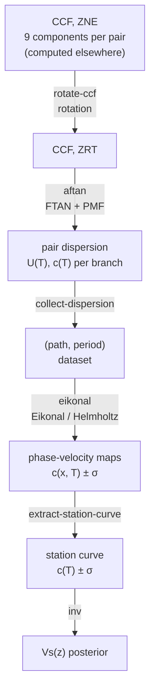

# Ambient Noise: Overview

!!! note "Draft"
    These method pages replace the older workflow pages step by step. The
    older pages (listed under *Previous pages* in the navigation) still hold
    the configuration keys and command details.

From ambient-noise cross-correlations to a phase-velocity curve under one
station, SeisForge runs four stages. Each page below derives one stage: what
is computed, why it works, which convention the code uses, and how it was
checked.



| stage | page | what goes in | what comes out | the key idea |
|---|---|---|---|---|
| rotation | [Rotation of multi-component CCFs](rotation.md) | nine ZNE CCFs, azimuth $\theta$, back azimuth $\psi$ | nine ZRT CCFs | $C' = S\,C\,\mathsf R^{\mathsf T}$, a different rotation at each station |
| dispersion | [Dispersion measurement](dispersion.md) | one ZRT CCF branch, distance $r$ | group and phase velocity vs period | envelope peak → $U$; phase at the peak → $c$, up to $2\pi N$ |
| tomography | [Eikonal and Helmholtz tomography](tomography.md) | path-average phase velocities of all pairs | local phase velocity per grid cell and period | $\lvert\nabla\tau\rvert = 1/c$, averaged over virtual sources |
| station curve | (glue, this page) | the stack | `period velocity sigma` for `seisforge inv` | bilinear sampling, uncertainty floor |

## How the stages connect

- **Component and branch bookkeeping.** The rotation fixes which way R and T
  point (in SeisForge both radial axes point from the receiver back to the
  virtual source). The phase constant $\phi_0$ that AFTAN removes depends on
  the component *and* on this convention, so the two pages must agree; for
  ZR and RZ they currently do not ([known issue](../aftan_phase_constants.md)).
- **Negative lags.** A CCF has a causal branch (A → B) and an acausal one
  (B → A). AFTAN measures either or both; `seisforge ant collect-dispersion`
  stores a negative-branch measurement as the reversed station pair, so the
  Eikonal stage sees two directed paths per pair.
- **Periods.** AFTAN reports measurements at instantaneous periods;
  `collect-dispersion` resamples phase velocity and SNR linearly onto
  integer periods, without extrapolation.
- **Cycle choices happen twice.** AFTAN picks the $2\pi$ branch of each pair
  against a reference curve; the Eikonal stage corrects remaining whole-period
  travel-time errors between neighbouring stations (at long periods only).
- **Uncertainty.** Only the last two stages produce one: the spread of
  single-source estimates in the Eikonal stack. `seisforge ant
  extract-station-curve` writes the standard error of the mean (default) or
  the spread, with a floor, as the one-sigma of the station curve.

## Checks shared by all pages

Every figure on these pages is made by a script in `docs/ant/scripts/` with
the same name as the image, from package functions and synthetic data with a
known answer, and runs in seconds:

```bash
PYTHONPATH=src python docs/ant/scripts/<figure name>.py
```

The SymPy derivation of the rotation
([executable page](scripts/rotation_derivation.py)) is executed on every
documentation build.
