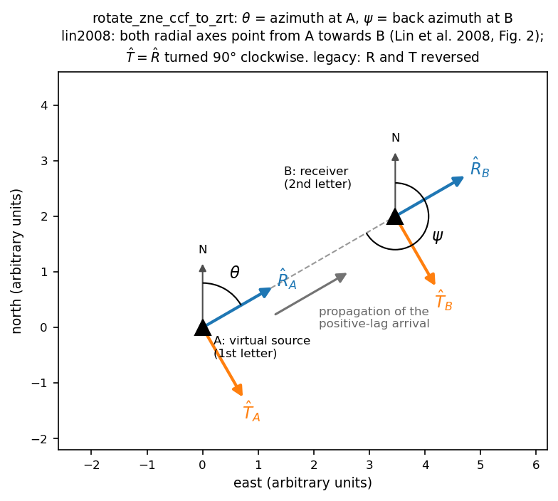

# Multi-Component Cross-Correlations: ZNE → ZRT

Noise cross-correlations (CCFs) are computed between the recorded channels of
two stations: vertical (Z), north (N) and east (E). Surface waves are
polarised relative to the path: Rayleigh waves in the vertical plane through
both stations (Z and radial, R), Love waves perpendicular to it (transverse,
T). Rotating the horizontal channels into path coordinates separates the two
wave types: Rayleigh waves on ZZ, ZR, RZ, RR and Love waves on TT. This page
derives the rotation of the full $3\times3$ correlation tensor and describes
`seisforge ant rotate-ccf`.

## 1. Conventions

**Correlation.** For a virtual source A and a receiver B,

$$
C_{ab}(t) = \int u_a^{A}(\tau)\, u_b^{B}(\tau + t)\, d\tau ,
$$

where the first letter is the component at A and the second the component at
B (`NZ` is N at A correlated with Z at B). A wave travelling from A to B with
group velocity $U$ appears at positive lag $t = r/U$. SeisForge reads the CCFs
and does not compute them. A correlation code with the opposite lag sign swaps
the two branches, and one that stores the receiver channel first swaps the
letters.

**Angles.** Both are measured clockwise from north: the azimuth $\theta$ is
the direction at A towards B, and the back azimuth $\psi$ the direction at B
towards A. On a sphere the great circle meets the two local meridians at
different angles, so $\psi \neq \theta + 180°$ in general. The rotation
therefore takes both angles.

**Axes.** As drawn in Fig. 2 of Lin, Moschetti & Ritzwoller (2008), R points
from the virtual source towards the receiver at **both** stations, along the
propagation of the positive-lag wave. T is R turned 90° clockwise, seen from
above. In (north, east) components:

| | radial $\hat R$ | transverse $\hat T$ |
|---|---|---|
| virtual source A | $(\cos\theta,\ \sin\theta)$ | $(-\sin\theta,\ \cos\theta)$ |
| receiver B | $(-\cos\psi,\ -\sin\psi)$ | $(\sin\psi,\ -\cos\psi)$ |

At A, $\hat R$ points towards B; at B it points away from A. On a flat Earth
($\psi = \theta + \pi$) the two stations have the same axes. T follows R as
E follows N, so (Z, R, T) has the handedness of (Z, N, E): both horizontal
bases are rotations with determinant $+1$. Reversing R and T at both stations
(another convention in use) changes the sign of ZR, RZ, ZT and TZ only, the
components with exactly one horizontal axis.



*The axes are read off `rotate_zne_ccf_to_zrt` by rotating unit
correlations (script `docs/ant/scripts/rotation_geometry.py`).*

## 2. The rotation

A correlation is bilinear in the two recordings. Projecting the motion at A
on a unit vector $\hat u$ and the motion at B on $\hat v$ gives

$$
C_{uv}(t) = \int (\hat u\cdot \mathbf{u}^A)(\tau)\,(\hat v\cdot\mathbf{u}^B)(\tau+t)\,d\tau
= \sum_{i,j\in\{Z,N,E\}} u_i\, C_{ij}(t)\, v_j .
$$

Write the new unit vectors (Z, R, T) of A as the rows of $M_s$ and those of B
as the rows of $M_r$, in Z, N, E order:

--8<-- "docs/ant/generated/rotation_matrices.md"

With $\mathbf C_{ZNE}$ the tensor whose row index is the source component and
whose column index is the receiver component,

$$
\boxed{\;\mathbf C_{ZRT} = M_s\,\mathbf C_{ZNE}\,M_r^{\mathsf T}\;}
\qquad\text{i.e.}\qquad
C_{ab} = \sum_{i,j} (M_s)_{ai}\, C_{ij}\, (M_r)_{bj} .
$$

$M_s$ (angle $\theta$) acts on the first letter and $M_r$ (angle $\psi$) on
the second. ZZ passes through unchanged; the other eight components are

--8<-- "docs/ant/generated/rotation_components.md"

ZR and ZT need only ZN and ZE, RZ and TZ need only NZ and EZ, and the four
horizontal components need NN, NE, EN and EE.

On a flat Earth ($\psi = \theta + \pi$) $M_r = M_s$: both stations use the
same rotation, and the formulas reduce to the familiar single-angle form used
by codes that set the back azimuth to $\theta + 180°$:

--8<-- "docs/ant/generated/rotation_flat.md"

The TT, RR, TR and RT coefficients equal eq. 1 of Lin et al. (2008).

The expressions above are not typed by hand. SymPy derives them from
$M_s\,\mathbf C_{ZNE}\,M_r^{\mathsf T}$, and the script that does this also
evaluates them for 200 random angle pairs and tensors and checks that they
agree with `seisforge.ant.rotation.rotate_zne_ccf_to_zrt` to $10^{-12}$.
`tests/test_rotation.py` checks the axes, Lin et al. (2008) eq. 1, and the
round trip through the inverse rotation `rotate_zrt_ccf_to_zne`.

??? example "Derivation script: `docs/ant/scripts/rotation_derivation.py`"

    ```python
    --8<-- "docs/ant/scripts/rotation_derivation.py"
    ```

## 3. Usage

```bash
seisforge ant rotate-ccf -c ccf_rotate.yml [options]
```

One run rotates one station pair. The config:

```yaml
io:
  input_template: CCF_ZNE/A_B_{component}.SAC   # {component}: ZZ ZN ZE NZ NN NE EZ EN EE
  output_template: CCF_ZRT/A_B_{component}.SAC  # {component}: ZZ ZR ZT RZ RR RT TZ TR TT
  overwrite: false              # true: replace existing outputs
rotation:
  components: [ZZ, ZR, RZ, RR, TT]  # default: all nine; only the ZNE files they need are read
  azimuth: 46.02                # theta, A -> B, degrees; give both or neither
  back_azimuth: 226.32          # psi, B -> A, degrees
```

**Templates.** Both are paths to SAC files (one trace per file) and must
contain `{component}`. The input template may contain shell wildcards (`*`,
`?`, `[...]`) if exactly one file matches each component. Relative paths are
relative to the config file. A missing input file is an error: the reciprocal
pair BA is never used instead, because its lags are reversed,
$C^{BA}_{ij}(t) = C^{AB}_{ji}(-t)$.

**Options** override the config keys of the same name:

| option | value |
|---|---|
| `-c`, `--config-file` | YAML config (required) |
| `--input-template`, `--output-template` | path templates as above |
| `--components` | comma-separated, e.g. `ZZ,ZR,RR` |
| `--azimuth`, `--back-azimuth` | degrees, both or neither |
| `--overwrite` | replace existing outputs |

Many pairs are a shell loop over `--input-template` and `--output-template`.

**Angles** come from the config or options, else from SAC `az`/`baz` of the
first input, else from `evla`/`evlo` (A) and `stla`/`stlo` (B) on the WGS84
ellipsoid.

**Outputs** are SAC files with the header of the first ZNE input and
`kcmpnm` set to the component. `rotate_ccf.log`, next to the outputs, records
the files, the angles and their source, and the software versions.

Example: `examples/01_ccf_rotate`; full reference config:
`examples/reference_configs/ccf_rotate.yml`.

## References

- Lin, F.-C., Moschetti, M. P., & Ritzwoller, M. H. (2008). Surface wave
  tomography of the western United States from ambient seismic noise:
  Rayleigh and Love wave phase velocity maps. *Geophysical Journal
  International*, 173(1), 281–298.
  [doi:10.1111/j.1365-246X.2008.03720.x](https://doi.org/10.1111/j.1365-246X.2008.03720.x)
