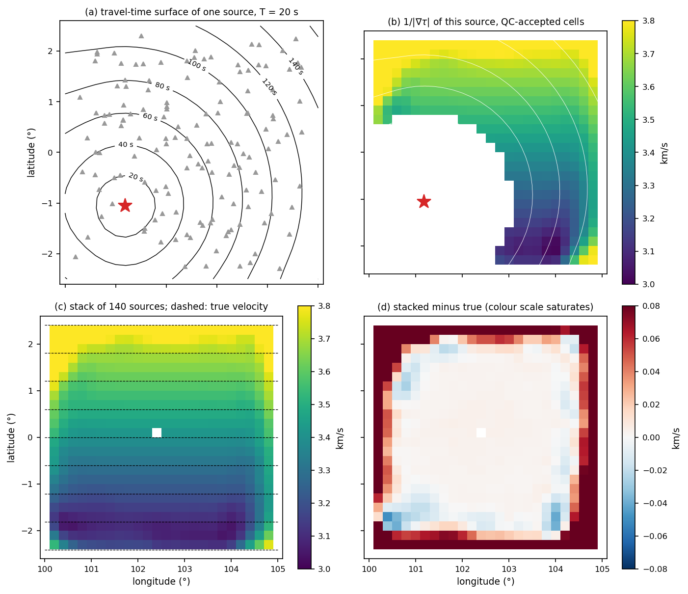

# Surface-Wave Eikonal and Helmholtz Tomography

!!! note "Draft"
    Method page under review. Statements that could not be checked against
    the code or a source are marked **Unverified**. Code references are to
    `seisforge.ant.eikonal` (`core.py`, `helmholtz.py`, `field.py`, `qc.py`,
    `cycle_skip.py`, `interpolation.py`, `stacking.py`).

The [dispersion measurement](dispersion.md) gives, for every station pair and
period, one number: the phase velocity averaged along the path. Tomography
turns these path averages into a map of local phase velocity. The classical
way is an inversion: assume rays, set up a linear system, regularise. Eikonal
tomography (Lin et al. 2009) takes a different route that needs no inversion
at all. Treat one station as a source; the phase travel times to all other
stations sample a *wavefront*; the local speed is read off the spacing of the
wavefronts, i.e. the gradient of the travel-time surface. Doing this for every
station as source and averaging gives the map, together with a spread that
serves as an error estimate.

This page derives why this works, when it does not, and what the code adds
to make it robust.

## 1. From the wave equation to the Eikonal equation

### A surface wave as a 2-D wave

At one frequency $\omega$ a fundamental-mode surface wave behaves, to a good
approximation, like a scalar wave on the Earth's surface whose local speed is
the phase velocity $c(\mathbf x)$ of the 1-D structure beneath $\mathbf x$.
Its displacement $u(\mathbf x)$ (vertical component, say) satisfies the 2-D
Helmholtz equation

$$
\nabla^2 u + \frac{\omega^2}{c(\mathbf x)^2}\,u = 0 ,
$$

with $\nabla$ the horizontal gradient. This "membrane" picture neglects mode
coupling and the depth dependence of the wavefield; it is the standing
assumption of 2-D surface-wave tomography (Wielandt 1993; Lin & Ritzwoller
2011). **Unverified** here: its error for strong lateral gradients.

### Split amplitude and phase

Write the wave as an amplitude and a phase travel time $\tau$,

$$
u(\mathbf x) = A(\mathbf x)\,e^{-i\omega\tau(\mathbf x)}
$$

(the sign matches the $e^{+i\omega t}$ time dependence of
[Dispersion §0](dispersion.md#0-notation-and-conventions): a crest at
$\omega t - \omega\tau$ = const travels outward as $t$ grows). Then

$$
\nabla u = (\nabla A - i\omega A\nabla\tau)\,e^{-i\omega\tau},
$$

$$
\nabla^2 u = \left[\nabla^2 A - \omega^2 A\,|\nabla\tau|^2 - i\omega\,(2\nabla A\cdot\nabla\tau + A\,\nabla^2\tau)\right]e^{-i\omega\tau}.
$$

Insert into the Helmholtz equation and separate real and imaginary parts:

$$
\text{real:}\quad |\nabla\tau|^2 = \frac{1}{c^2} + \frac{\nabla^2 A}{\omega^2 A},
\qquad
\text{imaginary:}\quad \nabla\cdot(A^2\,\nabla\tau) = 0 .
$$

The imaginary part is energy conservation along rays (the "transport
equation"): it ties the amplitude to the focusing of the wavefronts. The
real part is exact and is the basis of both methods.

### The Eikonal equation: the dropped term

If the amplitude varies slowly compared with the wavelength, the second term
on the right is small:

$$
\left|\frac{\nabla^2 A}{A}\right| \ll \frac{\omega^2}{c^2} = k^2 = \left(\frac{2\pi}{\lambda}\right)^2 .
$$

Dropping it gives the **Eikonal equation**

$$
\boxed{\;|\nabla\tau(\mathbf x)| = \frac{1}{c(\mathbf x)}\;}
$$

the high-frequency (ray) limit. The local slowness is the length of the
travel-time gradient; its direction is the local propagation direction.
The condition says when this holds: the amplitude must not curve on the scale
of a wavelength. It fails where wavefronts focus or defocus strongly, behind
anomalies comparable in size to $\lambda$, and where waves from different
directions interfere (then $A$ oscillates on the wavelength scale).

What the Eikonal equation measures is therefore an **apparent** phase
velocity $1/|\nabla\tau|$: the speed of the observed wavefront, which may
differ from the structural phase velocity $c$ where the amplitude term
matters (Wielandt 1993).

### The Helmholtz correction

Keeping the amplitude term is what Helmholtz tomography (Lin & Ritzwoller
2011) does:

$$
\boxed{\;\frac{1}{c^2} = |\nabla\tau|^2 - \frac{\nabla^2 A}{\omega^2 A}\;}
$$

(`helmholtz.corrected_slowness_squared_s2_per_km2`, with the correction from
`amplitude_laplacian_correction_s2_per_km2`; $\nabla^2 A$ is computed on the
interpolated amplitude field like $\nabla\tau$ below). The price is a second
derivative of a measured amplitude, which is far noisier than the first
derivative of a travel time; the correction is only usable with reliable
amplitudes and dense stations, and SeisForge applies it only where
`helmholtz.enabled` is set.

!!! warning "Unverified: amplitudes from noise correlations"
    The derivation needs the amplitude of a wave from one source. Whether
    the amplitudes of ambient-noise correlations (after the temporal and
    spectral normalisation usually applied before correlating) satisfy this
    has not been examined here; the code accepts any `amplitude` variable in
    the input dataset.

## 2. Building the travel-time surface

For one virtual source $s$ at one period $T$:

1. **Travel times.** Each receiver $j$ has a path-average phase velocity
   $\bar c_{sj}$ from AFTAN and a geodesic distance $d_{sj}$ (WGS84). The
   phase travel time is $\tau_j = d_{sj}/\bar c_{sj}$
   (`core.phase_travel_time_s`). The source itself is added as a point with
   $\tau = 0$.

2. **Cycle-skip correction** (periods $\ge$ `cycle_skip.min_period_s`,
   default 20 s). A wrong $2\pi$ branch in AFTAN shifts $\tau_j$ by a whole
   period. Starting from a seed station near the array centre, stations are
   visited by distance from the seed; each is predicted from its nearest
   already accepted neighbour $n$ with that neighbour's apparent velocity,
   $\tau_j^{\text{pred}} = d_{sj}\,\tau_n/d_{sn}$, shifted by the integer
   number of periods that brings it closest,
   $\tau_j \to \tau_j + \operatorname{round}\!\big((\tau_j^{\text{pred}} - \tau_j)/T\big)\,T$,
   and rejected if the remaining residual exceeds `max_residual_s` (10 s).
   Several seeds are tried and the one that keeps most stations wins
   (`cycle_skip.correct_cycle_skips`). The rule assumes the apparent velocity
   changes little between neighbouring stations.

3. **Interpolation** onto a regular longitude-latitude grid, in local
   equirectangular kilometres: a thin-plate-spline radial basis function
   (SciPy `RBFInterpolator`, default, `smoothing: 0` so the surface passes
   through the data) or GMT `surface`, a minimum-curvature spline in tension
   (Smith & Wessel 1990). The surface must be smooth enough to
   differentiate but must not invent structure; this is the main free choice
   of the method.

4. **Stability check.** The same data are interpolated a second time with
   different smoothing or tension (`comparison_smoothing`, 0.2); cells where
   the two surfaces differ by more than `max_travel_time_difference_s` (2 s)
   are rejected. Where the data constrain the surface, the choice of
   interpolant should not matter; where it matters, the gradient is not
   trustworthy.

5. **Gradient and Laplacian** by second-order finite differences in arc
    length (`core.scalar_field_gradient_per_km`): $x$ along each parallel,
    $y$ along the meridian. On the ellipsoid the parallels shrink towards the
    pole, which adds a metric term to the Laplacian,

    $$
    \nabla^2 f = f_{xx} + f_{yy} + \frac{1}{\rho}\frac{d\rho}{dy}\,f_y,
    \qquad \frac{1}{\rho}\frac{d\rho}{dy} = -\frac{\tan\varphi}{N(\varphi)},
    $$

    with $\rho = N\cos\varphi$ the radius of the parallel at latitude
    $\varphi$ and $N$ the prime-vertical radius (`laplacian_metric:
    ellipsoidal`; `locally_flat` drops the term, for comparison with old
    results only).

6. **Slowness, velocity and direction**:
   $s = |\nabla\tau|$, $c_{\text{app}} = 1/s$, propagation azimuth
   $\operatorname{atan2}(\partial_x\tau, \partial_y\tau)$ clockwise from north,
   and its deviation from the great-circle azimuth from the source (a
   diagnostic of off-path propagation).

*Synthetic test with an exact answer (`docs/ant/scripts/eikonal_synthetic.py`):
phase velocity increasing linearly to the north, for which the Eikonal
equation has a closed-form solution (circular rays,
$\tau = |G|^{-1}\operatorname{arccosh}[1 + G^2\ell^2/(2v_1v_2)]$, $\ell$ the
straight distance between the two points, $G$ the gradient), 140 randomly
placed stations, $T$ = 20 s, package defaults. (a) Travel-time surface of
one source. (b) Its apparent velocity; the blank disc is the near-source
mask (three wavelengths). (c) Stack of all sources. (d) Error: 0.005 km/s
RMS (0.13 %) in the interior, but large in the outer ring, where the
interpolation extrapolates beyond the stations and the gradient is one-sided.
The error at the edge passes every default QC test.*

## 3. Quality control of one source's field

Each grid cell gets the first reason that applies (`RejectionReason`), in
this order (defaults in brackets):

| test | rejects | why |
|---|---|---|
| non-finite or next to a non-finite cell | holes in the interpolation | the finite-difference stencil would use them |
| interpolation unstable [2 s] | cells where two interpolants disagree | gradient not constrained by data |
| station coverage [a station within 150 km, or stations in all 4 quadrants within 250 km] | cells far from any station | extrapolation |
| apparent velocity outside [2, 5] km/s | wild gradients | physically implausible for crustal periods (an assumed range; adjust for other targets) |
| distance to source $< n\lambda$ [$n = 3$, $\lambda = 3.5\ \text{km/s} \times T$] | near-source cells | wavefront strongly curved; far-field phase of [Dispersion §1](dispersion.md#1-the-phase-of-a-noise-correlation) and the interpolation both poor |
| $\lvert\nabla^2\tau\rvert >$ 0.005 s/km² | strongly curved wavefronts | near sources, caustics, interference |
| outer grid cells [1] | the boundary | one-sided differences |

A source field is used only if at least 5 % of the grid passes
(`source_field.min_valid_fraction`). For the Helmholtz field there are
further tests: the amplitude field must be positive, stable to 1 % between
interpolants, and the correction must satisfy
$|\nabla^2A/(\omega^2A)| \le 1/v_{\text{ref}}^2$ with $v_{\text{ref}}$ =
4 km/s, and the corrected $1/c^2$ must be positive.

!!! note "Reading the curvature limit"
    For a circular wavefront at distance $R$ from its source,
    $\nabla^2\tau = 1/(cR)$. The limit 0.005 s/km² thus corresponds to
    $R = 1/(0.005\,c) \approx 57$ km at 3.5 km/s: a wavefront curved more
    tightly than a circle of that radius is rejected (derived here). At
    20 s the three-wavelength mask (210 km) is much stricter, so the
    curvature test matters mainly for focusing and interference, not for
    distance from the source.

!!! warning "Unverified: the Helmholtz correction limit"
    $1/v_{\text{ref}}^2$ equals the squared slowness itself, so the test only
    rejects corrections that are as large as the quantity being corrected.
    Whether a tighter default would be better has not been studied.

## 4. Combining many virtual sources

Each source gives an independent-looking estimate of the same local
slowness, seen from a different direction. In each cell the code
(`stacking.stack_event_fields`):

1. keeps sources whose cell passed QC; cells with fewer than
   `min_raw_measurements_per_cell` (50) are left empty;
2. **weights by direction**: a source gets weight $1/n$, $n$ the number of
   sources whose great-circle azimuth at this cell is within ±20° of its own
   (a source with no such neighbour is dropped, `require_peer`), so that a
   cluster of stations in one direction does not dominate; weights larger
   than the mean plus 3 standard deviations are capped; weights are
   normalised to sum to 1;
3. **rejects outliers** beyond 2 weighted standard deviations of the
   slowness (one iteration);
4. averages **slowness**, not velocity:
   $\bar s = \sum_e w_e s_e$, $c = 1/\bar s$.

Averaging slowness is the natural choice because slowness is what the
gradient measures and what adds along paths; averaging velocities instead
gives a slightly higher value (by Jensen's inequality, the difference is of
the order of the relative variance; derived here).

### Uncertainty

Two spreads are written per cell:

$$
\sigma_c = \Big[\tfrac{n}{n-1}\sum_e w_e (c_e - \bar c_w)^2\Big]^{1/2},
\qquad
\sigma_{\bar c} = \frac{\sigma_c}{\sqrt{n_{\text{eff}}}},\quad n_{\text{eff}} = \frac{1}{\sum_e w_e^2},
$$

with $c_e = 1/s_e$ and $\bar c_w$ their weighted mean: the spread of single
source estimates and the standard error of the mean. $n_{\text{eff}}$ is the
number of equally weighted sources that would give the same variance of a
weighted mean.

The standard error assumes the sources are independent. They are not: the
same stations enter every source's surface, and neighbouring sources see
almost the same wavefront. $\sigma_{\bar c}$ is therefore a lower bound,
and it becomes implausibly small where many sources overlap
(a floor on it is advisable for this reason; `examples/full_chain` uses one). Systematic errors
common to all sources (a wrong phase constant, a biased interpolant at the
edges, as in panel (d) above) are not in either number. The cell also
records the directional coverage, $360°$ minus the largest azimuthal gap
between contributing sources.

!!! warning "Unverified: scaling of the standard error"
    Lin et al. (2009) discuss how to turn the spread into an uncertainty for
    correlated sources; how their choice compares with
    $\sigma_c/\sqrt{n_{\text{eff}}}$ has not been checked for this draft.

## 5. Quality control: when the method fails

The method rests on four assumptions; each has a typical failure.

| assumption | breaks down when | symptom | guard in SeisForge |
|---|---|---|---|
| amplitude term negligible ($\lvert\nabla^2A/A\rvert \ll k^2$) | anomalies of size $\lesssim\lambda$; behind strong focusing; interference of several waves | apparent velocity biased, often with a pattern aligned with the source direction | Helmholtz correction; azimuthal averaging cancels part of it |
| travel time is a smooth single-valued surface | multipathing, cycle skips, near the source | stripes or rings in $c_{\text{app}}$, large $\nabla^2\tau$ | cycle-skip correction, curvature limit, near-source mask |
| stations sample the wavefront densely | station spacing comparable to $\lambda$ (short periods); gaps; edges | smooth but wrong surface; edge artefacts (panel d) | interpolation stability, station coverage, boundary mask |
| path-average phase velocities are correct | wrong $2\pi$ branch; wrong phase constant (ZR, RZ, see [Dispersion §1](dispersion.md#component-by-component)); short paths | constant offset of $\tau$ for some stations; bias common to all sources | cycle-skip correction at long periods only; none for a wrong constant |

Practical consequences:

- **Resolution** is set by the station spacing and the wavelength together,
  not by a regularisation parameter: features smaller than about one
  wavelength, or than the distance between stations, are not resolved.
- **Short periods** suffer from the station spacing (few samples per
  wavelength) and from cycle skips, which are corrected only from 20 s up by
  default.
- **Long periods** suffer from the near-source mask: at 40 s the default mask
  is 420 km, so in a small array few cells survive for any source.
- **Edges** are optimistic: the synthetic shows errors above 0.08 km/s in
  cells that pass every default test. Do not interpret the outer ring of a
  stack without checking the station distribution.
- **Anisotropy** makes the slowness depend on the propagation direction; the
  isotropic stack averages over directions, which is correct only if the
  azimuthal coverage is even (hence the weighting). SeisForge does not
  estimate anisotropy.

## 6. Input and output

The input is a (path, period) dataset of path-average phase velocities and
station coordinates, written by the user's own script from the dispersion
measurements; the output is the stack of maps with their spreads. The maps
can be used directly, or sampled at stations or grid points for a depth
inversion of any kind (`examples/full_chain/glue.py` samples one station
bilinearly for `seisforge inv`). Configuration keys and the input contract
are on the [previous page](../eikonal_workflow.md) until they move here.

## References

- Lin, F.-C., Ritzwoller, M. H., & Snieder, R. (2009). Eikonal tomography:
  surface wave tomography by phase front tracking across a regional
  broad-band seismic array. *Geophysical Journal International*, 177(3),
  1091–1110.
  [doi:10.1111/j.1365-246X.2009.04105.x](https://doi.org/10.1111/j.1365-246X.2009.04105.x)
- Lin, F.-C., & Ritzwoller, M. H. (2011). Helmholtz surface wave tomography
  for isotropic and azimuthally anisotropic structure. *Geophysical Journal
  International*, 186(3), 1104–1120.
  [doi:10.1111/j.1365-246X.2011.05070.x](https://doi.org/10.1111/j.1365-246X.2011.05070.x)
- Smith, W. H. F., & Wessel, P. (1990). Gridding with continuous curvature
  splines in tension. *Geophysics*, 55(3), 293–305.
  [doi:10.1190/1.1442837](https://doi.org/10.1190/1.1442837)
- Wielandt, E. (1993). Propagation and structural interpretation of
  non-plane waves. *Geophysical Journal International*, 113(1), 45–53.
  [doi:10.1111/j.1365-246X.1993.tb02527.x](https://doi.org/10.1111/j.1365-246X.1993.tb02527.x)
