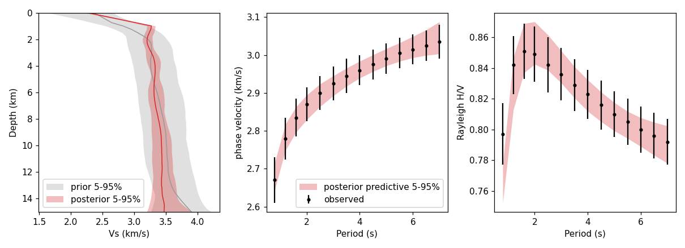

# Getting started: a single-station inversion

This page runs the example in `examples/STA001` from start to finish: a
Bayesian (MCMC) inversion of Rayleigh phase velocity and Rayleigh H/V for
Vs(z) in the upper 15 km. It takes about two minutes on one core.

The [model guide](model.md) explains the model space, and the
[configuration reference](inv_usage.md) lists every key.

## 1. The station folder

```text
examples/STA001/
  obs.yaml        what the data are, and how synthetics are computed
  inv.yaml        model, priors, constraints, likelihood, sampler
  vph_disp.dat    period_s  phase_velocity_km_s  sigma_km_s
  hv.dat          period_s  rayleigh_hv  sigma
```

The two YAML files have separate jobs. `obs.yaml` is usually written once per
station; `inv.yaml` is the file you edit while testing inversion strategies.
Data files have three columns (period, value, one-sigma uncertainty) and may
contain `#` comments.

`inv.yaml` describes a gradient sediment segment (0-1 km) over a cubic B-spline
crust (1-15 km) with eight coefficients, so the sampler explores ten scalar
parameters:

```text
sediment.vs_top, sediment.vs_bottom, crust.c0 ... crust.c7
```

## 2. Sample the prior first

Copy the folder somewhere outside the repository and run, from inside it:

```bash
seisforge inv disp-hv --inv inv.yaml -o run_prior --prior-only --progress
```

`--prior-only` ignores the data. The chains sample the model space allowed by
the parameter bounds and the hard constraints in `inv.yaml`. This answers
"which Vs(z) profiles does my prior allow?" before any data are involved. If a
plausible profile is outside this ensemble, no amount of data will recover it.

## 3. Run the posterior

```bash
seisforge inv disp-hv --inv inv.yaml --obs obs.yaml -o run_disp_hv --progress
```

`inv disp` and `inv hv` invert one data type; `inv disp-hv` inverts both.
An existing output directory is not overwritten unless `--overwrite` is given.
The example uses four chains in series (`Sampler.executor: serial`); with
`executor: thread` they run in parallel, because the forward solvers release
the GIL.

The output directory contains:

| file | content |
|---|---|
| `disp_hv_mcmc.nc` | parameter samples `theta(chain, draw, parameter)`, log prior and log likelihood terms, acceptance |
| `disp_hv_vs.nc` | Vs(z) for every sample, plus depth-wise `mean`, `median`, `p05`...`p95`, `best_vs` |
| `disp_hv_predictive.nc` | predicted dispersion and H/V for every sample, with the observations |
| `disp_hv.log` | settings, acceptance rates, best theta |
| `resolved_inv.yaml`, `resolved_obs.yaml` | snapshots of the inputs |

## 4. Look at the result

```python
import matplotlib.pyplot as plt
import xarray as xr

prior = xr.open_dataset("run_prior/disp_hv_prior_vs.nc")
post = xr.open_dataset("run_disp_hv/disp_hv_vs.nc")
pred = xr.open_dataset("run_disp_hv/disp_hv_predictive.nc")
mcmc = xr.open_dataset("run_disp_hv/disp_hv_mcmc.nc")
print("acceptance per chain:", mcmc.acceptance_rate.values)

fig, (ax_vs, ax_c, ax_hv) = plt.subplots(1, 3, figsize=(11, 4))
for ds, color, label in ((prior, "0.6", "prior"), (post, "C3", "posterior")):
    # Use ds["median"], not ds.median: the latter is the xarray method.
    ax_vs.fill_betweenx(ds["depth"], ds["p05"], ds["p95"], color=color, alpha=0.3, lw=0,
                        label=f"{label} 5-95%")
    ax_vs.plot(ds["median"], ds["depth"], color=color, lw=1)
ax_vs.set(xlabel="Vs (km/s)", ylabel="Depth (km)", ylim=(15, 0))
ax_vs.legend(loc="lower left")

for ax, name, obs, unit in ((ax_c, "dispersion", "observed_velocity", "phase velocity (km/s)"),
                            (ax_hv, "hv", "observed_hv", "Rayleigh H/V")):
    period = pred[f"{name}_period"]
    ax.fill_between(period, pred[f"{name}_p05"], pred[f"{name}_p95"], color="C3", alpha=0.3, lw=0,
                    label="posterior predictive 5-95%")
    ax.errorbar(period, pred[f"{name}_{obs}"], pred[f"{name}_sigma"], fmt="k.", label="observed")
    ax.set(xlabel="Period (s)", ylabel=unit)
ax_c.legend(loc="lower right")
fig.tight_layout()
plt.show()
```



What to check:

- **Acceptance** (about 0.17 here). Roughly 0.15-0.4 is healthy for random-walk
  Metropolis. Much lower means `proposal.sigma` is too large; much higher
  means it is too small and the chains move slowly.
- **Posterior vs prior.** Where the posterior band is as wide as the prior
  band, the data do not constrain that depth range. Compare the bottom of the
  model with the period range of the data before interpreting it.
- **Predictive fit.** The observations should fall inside the posterior
  predictive band, given their error bars. A systematic offset points to a
  model space that cannot fit the data (too narrow bounds, too strict
  constraints, too few B-spline coefficients) rather than to the sampler.
- **Convergence.** `mcmc.split_rhat` should be close to 1 (below 1.1, and
  1.01 for final results) and `mcmc.effective_sample_size` at least a few
  hundred; `mcmc.attrs["lagging_chains"]` lists chains stuck in a lower mode.
  The log file repeats these and warns when they fail.
- **Forward failures.** `mcmc.forward_failure_rate` is the fraction of
  proposals inside the prior for which disba found no solution (rejected).
  It should be near 0; the log warns above 1 % and names the most frequent
  error. See [forward-solver failures](inv_usage.md#forward-solver-failures).

!!! warning "The example run has not converged"
    With the example's 4 chains x 5000 steps, the shallow parameters are
    fine (sediment and `crust.c0`-`c1`: R-hat 1.02-1.03, ESS 130-320), but the
    deeper B-spline coefficients mix far too slowly: `crust.c4`-`c6` have
    R-hat 1.34-1.77 and an ESS of 4-9. The deeper part of the posterior band
    in the figure is therefore not a result, only an illustration of the
    workflow. No chain is lagging, so this is slow mixing within one mode,
    not a stuck chain: longer chains (or larger, better-tuned steps for the
    deep coefficients) are needed before reading the deep structure.

## 5. Next steps

- Change the model: segment depths, profile types, bounds, and constraints.
  The [model guide](model.md) explains how these define the prior.
- Invert interface depths (sediment thickness, Moho depth) or a gradational
  interface: [model guide, section 3](model.md#3-interfaces).
  `examples/configs/interface_model.yml` is a complete example.
- Inspect a model in Python before a long run:
  [model guide, section 6](model.md#6-inspect-a-model-before-sampling).
- Drive a run from Python instead of the CLI:

```python
from seisforge.inv import run_inversion

result = run_inversion(kind="disp_hv", inv_file="inv.yaml", obs_file="obs.yaml",
                       output="run_disp_hv", progress=True)
```
