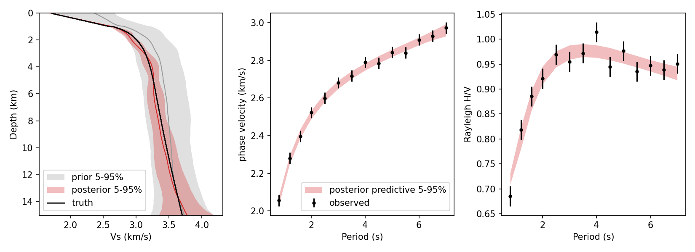

# 06 Inversion: Vs(z) from phase velocity and H/V at one station

Bayesian (MCMC) inversion of one station's Rayleigh-wave phase velocity and
Rayleigh H/V (ellipticity) for shear velocity Vs versus depth, 0-15 km. The
data are synthetic, computed from a known model (station name STA001), so you
can see whether the result is right. The full walk-through is
`docs/inv_getting_started.md`; every config key is in
`examples/reference_configs/inversion_inv.yaml` and `inversion_obs.yaml`.

## Input

| file | what it is |
|---|---|
| `data/vph_disp.dat` | Rayleigh phase velocity: `period_s  velocity_km_s  sigma_km_s` |
| `data/hv.dat` | Rayleigh H/V: `period_s  hv  sigma` |
| `obs.yaml` | which data files to use |
| `inv.yaml` | model, prior bounds, layering, sampler |
| `data/true_model.dat` | the truth (only for checking; not read by the inversion) |

Data files are plain text with three columns: period in seconds, value, and
one standard deviation of the value. Lines starting with `#` are comments.
`sigma` is used as the data uncertainty, so it sets how closely the result
fits the data. From `data/vph_disp.dat`:

```text
# period_s  rayleigh_phase_velocity_km_s  sigma_km_s
0.80 2.0559 0.030
1.20 2.2805 0.030
1.60 2.3963 0.030
```

From `data/hv.dat`:

```text
# period_s  rayleigh_hv  sigma
0.80 0.6854 0.020
1.20 0.8182 0.020
1.60 0.8854 0.020
```

The two files may have different periods. Phase velocity curves can come
from the ambient-noise examples (`02_aftan`, `03_eikonal`, and
`seisforge ant extract-station-curve`, see `full_chain`). SeisForge does not
measure H/V from data yet; take it from another program.

## Run

```bash
bash run.sh
```

It runs a prior-only inversion (about 6 s), the inversion with data (about
80 s with the four chains in four processes, measured on a 10-core Apple M4;
about four times longer on one core) and draws `result.png`. To run again,
delete `output/` first: existing results are never overwritten.

## Output

| file | what it is |
|---|---|
| `output/posterior/disp_hv_vs.nc` | Vs(z) of every sample, with depth-wise `median`, `p05` ... `p95` |
| `output/posterior/disp_hv_mcmc.nc` | parameter samples, convergence numbers (`split_rhat`, `effective_sample_size`) |
| `output/posterior/disp_hv_predictive.nc` | data predicted by every sample, with the observations |
| `output/posterior/disp_hv.log` | settings, layering error, acceptance, warnings |
| `output/prior/...` | the same for the prior-only run (no data) |
| `result.png` | prior and posterior Vs(z) with the truth, and the data fit |

## How to tell the result is right

`result.png` should look like `expected_result.png`:



`run.sh` prints these numbers; on this data they are exactly:

| number | this example | acceptable |
|---|---|---|
| max split R-hat | 1.007 | below 1.01 (below 1.1 at least) |
| min effective sample size | 541 | above 400 |
| lagging chains | none | none |
| truth inside posterior 5-95 % band | 241 of 241 depths | nearly all |
| `layering_error_at_initial` in `output/posterior/disp_hv.log` | 0.027 sigma (phase velocity), 0.077 sigma (H/V) | well below 1 |

The numbers are bit-for-bit reproducible with the same SeisForge version on
the same platform (fixed seed); another platform may differ in the last
digits of the samples but not in the conclusions.

Results that look wrong, and the usual cause:

- **R-hat above 1.1 or a lagging chain**: chains have not mixed. Increase
  `sampler.n_steps` and `burn_in`.
- **Posterior band as wide as the prior band** at some depths: the data do
  not constrain those depths (normal below about 10 km here: the longest
  period, 7 s, loses sensitivity).
- **Observations outside the predicted band** in the right two panels: the
  model cannot fit the data; widen prior bounds, or relax `constraints`.
- **The log warns "forward failures"**: disba found no solution for many
  models; see `docs/inv_usage.md#forward-solver-failures`.
- **Layering error near or above 1 sigma**: the forward layers are too thick
  for your periods; make `discretization.dz` smaller.

## Using your own data

1. `data/vph_disp.dat`, `data/hv.dat`: replace with your files (same three
   columns). To invert only one data type, run `seisforge inv disp` or
   `seisforge inv hv` instead of `inv disp-hv` and remove the other file from
   `obs.yaml`.
2. `obs.yaml`, `file:` lines: your file names.
3. `inv.yaml`, `model.segments`: `top_km`/`bottom_km` of each layer group.
   As a rule of thumb the model bottom is about half the longest wavelength
   (longest period times its phase velocity, divided by 2).
4. `inv.yaml`, `inversion.parameters`: `prior.bounds` (km/s) for your area,
   and `initial` inside them.
5. `inv.yaml`, `discretization.zmax`: the model bottom; check the logged
   layering error after the first run.
6. `inv.yaml`, `constraints`: `depth_range` to your model depth.
7. `inv.yaml`, `sampler.executor`/`max_workers`: `serial` on a one-core
   machine; `n_steps`/`burn_in` longer if R-hat or ESS fail.

There are no defaults for the model and the priors: they are your scientific
choice. Run `bash run.sh` again and check the numbers above.
